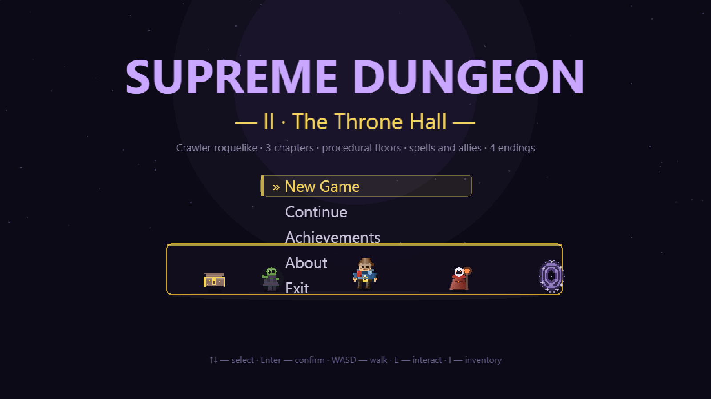
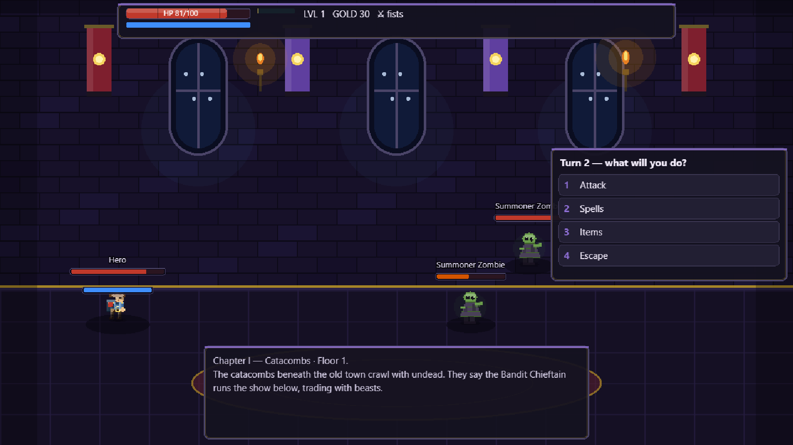
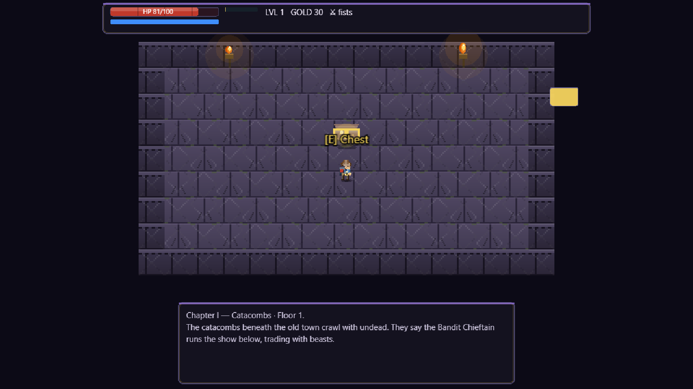
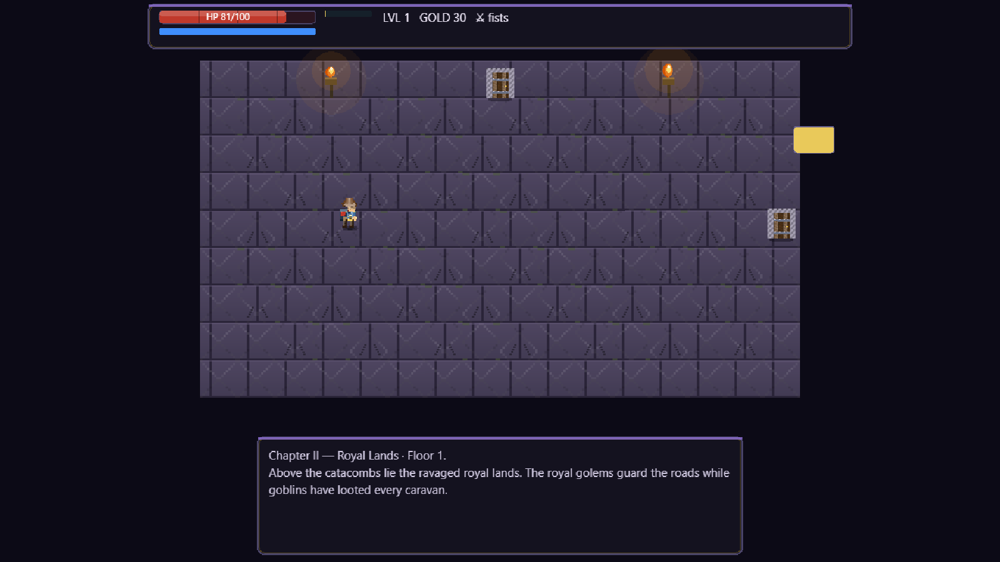
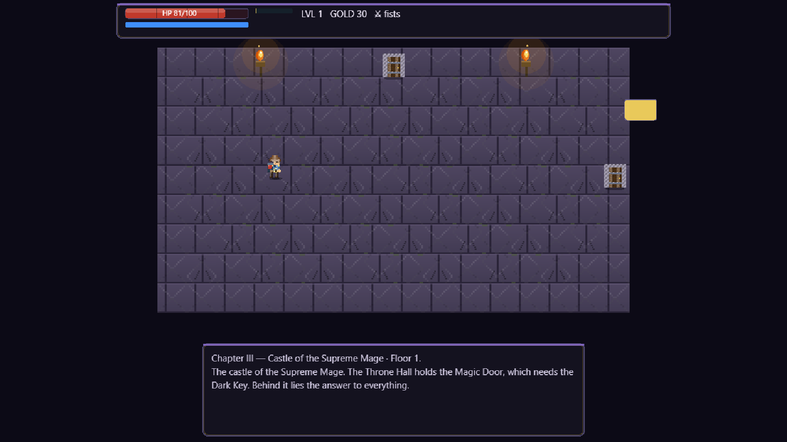

# Supreme Dungeon II — The Throne Hall

**Crawler roguelike · 3 chapters · procedural floors · spells and allies · 4 endings.**

Below the old town lie the Catacombs. Above them — the ravaged Royal Lands. And above it all, the Castle of the Supreme Mage, where the Magic Door waits for the Dark Key. Gather spellbooks, hire allies, shatter the passage seal — and face what gathers behind the throne.



## Screenshots

| Battle | Chest room |
|---|---|
|  |  |

| Chapter II | Chapter III |
|---|---|
|  |  |

## Features

- 3 chapters (Catacombs → Royal Lands → Castle) with procedural floors, elites and chapter bosses
- 5 combat spells (Fireball, Heal, Ice Spike, Shadow Bolt, Earthquake) with statuses: burning, frozen, poison, stun
- Hireable allies (Elven Archer, Dwarven Warrior, Healer Mage) who fight and heal beside you
- Special Supreme Mage events: mockery, cruelty, dialogue, reflection, time loop
- Arena waves, magic garden, ancient library, mysterious passages, mimics
- Achievements, hall of fame, 3 save slots, New Game / Continue
- ESC pause menu with resume / exit to title
- Full English localization

## Controls

| Key | Action |
|---|---|
| WASD | Walk |
| E | Interact (chests, fountains, traders, allies, doors…) |
| I | Inventory (equip weapons with a click) |
| 1–9 | Menu and battle actions |
| ESC | Pause menu / leave trader |
| Enter | Confirm |
| F11 or Alt+Enter | Fullscreen |

## Download — v1.0.0

| File | OS | How to run |
|---|---|---|
| `SupremeDungeonII-1.0.0-portable.exe` (~77 MB) | Windows 10/11 x64 | Download and run — no install needed |
| `SupremeDungeonII-1.0.0-setup.exe` (~78 MB) | Windows 10/11 x64 | Installer with Start-menu shortcut |
| `SupremeDungeonII-1.0.0-linux-x64.tar.gz` (~120 MB) | Linux x64 | Extract and run `./supreme-dungeon-ii` |

System requirements: 64-bit OS, ~300 MB disk, any GPU from the last 10 years (PixiJS WebGL, software fallback included).

> The Windows builds are not code-signed, so SmartScreen may warn on first launch: **More info → Run anyway**.

Linux run:
```bash
tar -xzf SupremeDungeonII-1.0.0-linux-x64.tar.gz
cd linux-unpacked
./supreme-dungeon-ii
```

## For developers

```bash
npm install
npm test        # 30 gameplay tests
npm run shot    # screenshot gate — 17 scenes
npm run dist:win / dist:linux
```

Built with Electron + PixiJS. Game logic lives in `src/core/` and is covered by tests.
